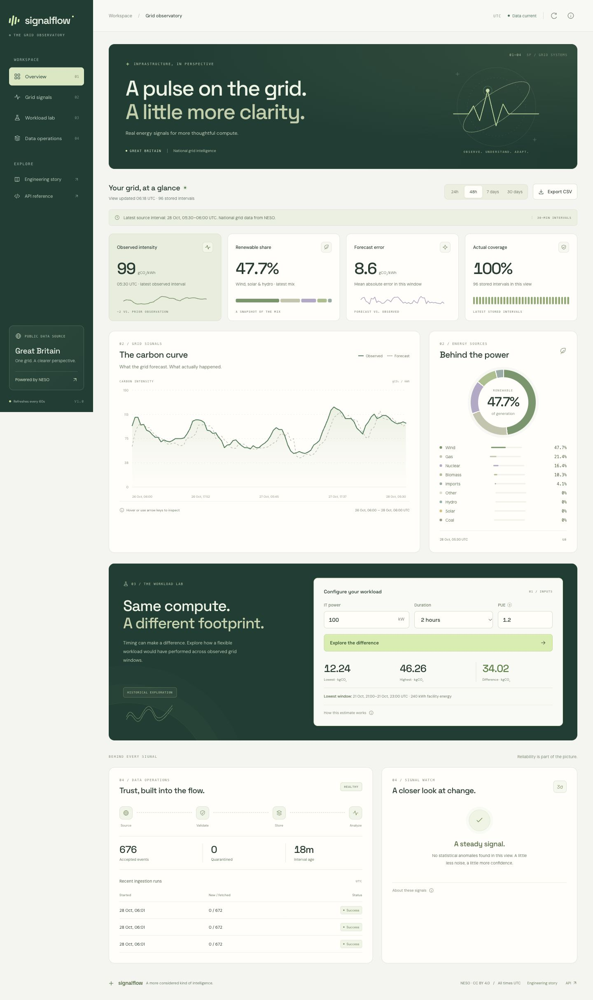

# SignalFlow

**Public grid signals → reliable data pipelines → carbon-aware infrastructure analytics.**

A portfolio engineering project built for a transition from product design into data engineering, data analytics, analytics engineering, and software engineering. SignalFlow collects real NESO national grid data, retains raw provenance, validates and materializes observations, flags statistical deviations, and serves an operational dashboard and read-only API.



## Run locally

Python 3.9+ is required. No API key or Docker is needed for the verified local path.

```sh
make setup
make ingest
make serve
```

Open **http://127.0.0.1:8000**. In a second terminal, run `make worker` for five-minute source polling. The UI refreshes stored data every minute. Source observations are half-hour intervals; this is near-real-time grid analytics, not subsecond telemetry.

```sh
make test                  # deterministic tests; no source network required
make check                 # dataset freshness and direct-run status; nonzero on unhealthy data
```

Use `.venv/bin/python -m signalflow.cli ingest --days 30` for a longer backfill. An empty database shows an explicit empty state. Source outages preserve stored observations and surface failure/freshness status. No fake records are substituted.

## What works

| Area | Implementation |
| --- | --- |
| Ingestion | Real public carbon intensity + generation mix, daily UTC chunks, bounded retries, backfills and five-minute polling |
| Data reliability | Transactional raw event claims, SHA-256 deduplication, revisions, nullable actuals, complete mix replacement, quarantine and durable run metadata |
| Storage | Verified SQLite and PostgreSQL stores; running Compose deployment |
| Analytics | Observed/forecast comparison, MAE, actual coverage, renewable share, rolling anomalies, contiguous historical workload scenarios |
| Product | Responsive dashboard, time-range selection, SVG chart, CSV export, workload calculator, provenance and freshness |
| Backend | FastAPI, OpenAPI, parameter validation, health checks, security headers, Prometheus endpoint |
| Optional platform | Kafka producer/consumer + DLQ, manual offset commits, dbt staging/daily mart/tests, Airflow reconciliation DAG |
| Portfolio | [Case study](docs/case-study.md), [role-specific bullets](docs/portfolio.md), architecture, screenshots, measured verification |

## Verified evidence

On October 27, 2026 (America/Los_Angeles), a real seven-day source backfill fetched **672 unique source events**, creating **336 intensity intervals** and **3,024 fuel rows**, with **0 rejected records**. Exact replay of all 672 events created **0 new events**. See [captured verification data](docs/verification-data.json) for UTC timestamps and scenario outputs.

The local test suite covers ingestion, revisions, validation, retries, failure durability, missing values, anomaly math, scenario units/gaps, API responses, CSV exports and Kafka consumer commit/dead-letter behavior using test doubles. Browser checks verify real data rendering, time-range changes and scenario output. Tests do not constitute a real Kafka cluster test.

**Container verification completed:** Docker Desktop 4.97.0 / Engine 29.9.2 is installed and running. All 37 tests pass against both SQLite and PostgreSQL. A real seven-day backfill traversed Kafka into PostgreSQL; exact replay of 674 stored events created no new raw events, and lag reached zero on all three partitions. dbt built two models and passed all 12 quality tests; the three-task Airflow DAG completed successfully and its scheduler heartbeat passed. See [integration evidence](docs/integration-evidence.json). Remote GitHub Actions, cloud deployment and throughput benchmarks remain unverified.

The running container dashboard is at **http://127.0.0.1:8001**; the original SQLite demo remains at port 8000. Compose defaults to port 8000; use `SIGNALFLOW_PORT=8001` to run alongside it.

## API

- `/api/overview?hours=48`: metrics, intervals, generation mix, anomalies, run health and recent quarantines.
- `/api/scenario?power_kw=100&duration_hours=2&pue=1.2`: lowest/highest contiguous observed windows in seven days of stored data.
- `/api/export.csv?hours=168`: interval extract with raw-event references.
- `/health`: database readiness (HTTP 503 on failure).
- `/metrics`: Prometheus scrape output.
- `/docs`: interactive OpenAPI reference.
- `/case-study`: technical project presentation.

Time-range bounds are 6–720 hours; scenario inputs are bounded and duration must be a half-hour multiple. All timestamps are UTC.

## Distributed deployment

```sh
# Choose direct ingestion:
docker compose --profile polling up --build -d
# Or Kafka-backed ingestion:
docker compose --profile streaming up --build -d
# Optional daily reconciliation + warehouse build:
docker compose --profile polling --profile orchestration up --build -d
```

Read the [runbook](docs/runbook.md) before deployment. Compose credentials and the Airflow standalone service are for local demonstrations. No paid infrastructure is provisioned. The complete Python/Kafka/Airflow system requires persistent compute and cannot be deployed as a static website.

## Repository map

```text
signalflow/       ingestion, SQLAlchemy store, Kafka transport, analytics, CLI, API
  static/         dashboard and case-study page; no frontend build step
analytics/        dbt PostgreSQL staging, daily mart and quality tests
orchestration/    Airflow DAG and isolated pipeline environment
scripts/          deterministic CI-only seed
tests/            isolated unit and API tests, captured public-source fixture
docs/             architecture, runbook, case study, portfolio copy, evidence
```

[Architecture and data contracts](docs/architecture.md) · [Operations](docs/runbook.md) · [Analytical SQL](docs/analysis.sql) · [Verification](docs/verification.md) · [Interface design](docs/design.md)

## Data meaning and attribution

Data: [NESO Carbon Intensity API](https://api.carbonintensity.org.uk/), licensed CC BY 4.0. API definitions: https://carbon-intensity.github.io/api-definitions/.

Carbon intensity is national grid gCO₂/kWh. Renewable share here means wind + solar + hydro, excluding biomass. Workload outputs are historical, location-based operational emissions estimates; they do not predict future savings or include embodied emissions. No energy prices, GPU utilization or data-center telemetry are ingested. No data engineering employment experience, operating savings, production scale, or distributed-system performance is implied by this portfolio project.
