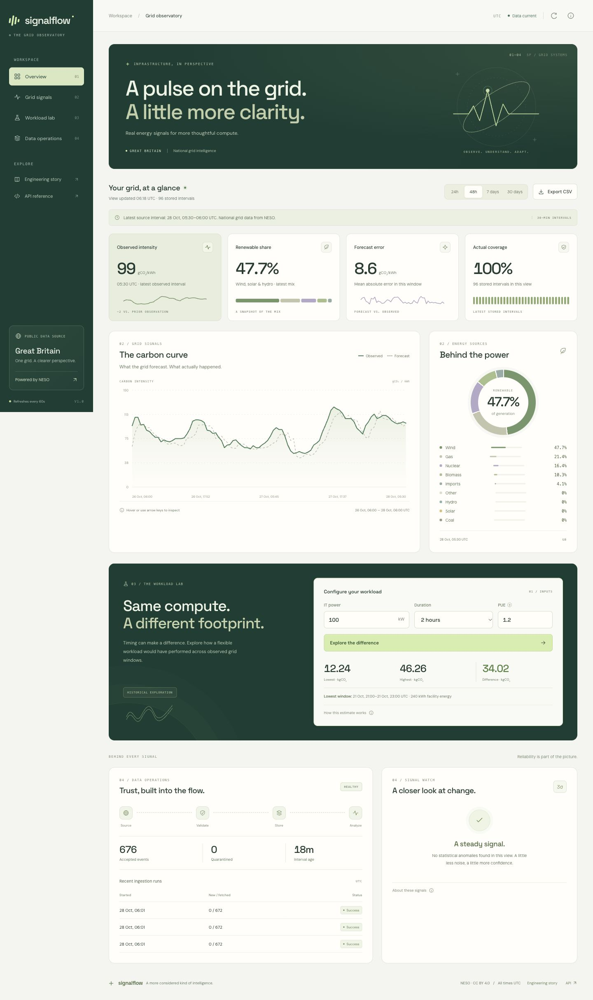

# SignalFlow

A pipeline and dashboard for Great Britain's grid carbon intensity and generation mix. It keeps forecasts separate from observed results and records revisions when source readings change.

The project explores a common data problem: the same event can arrive twice, actuals can arrive late, and newer source data can disagree with an earlier version.

**Python · FastAPI · SQLAlchemy · SQLite / PostgreSQL · Kafka · dbt · Airflow**



[Case study](docs/case-study.md) · [Architecture](docs/architecture.md) · [Verification](docs/verification.md)

## Run the demo

Use Python 3.12 and `make`. The default path uses SQLite and needs no Docker or API key.

```sh
git clone https://github.com/anushaxrama/signalflow.git
cd signalflow
make setup
make ingest
make serve
```

Open [localhost:8000](http://127.0.0.1:8000). Ingestion downloads the preceding seven days into an ignored local database. Run `make worker` in another terminal to revisit recent intervals every five minutes.

The dashboard refreshes stored results every minute; it does not trigger ingestion. Source observations cover half-hour intervals.

## What to explore

- Carbon intensity, forecast error, generation mix, missing values, and source freshness.
- Revised readings that update an interval without erasing an existing actual value.
- Exact replays that add no new event.
- CSV export and a historical comparison of the same electrical workload at different times.

The workload comparison uses IT power, duration, and power usage effectiveness. It is a hindsight calculation, not a forecast or promise of savings.

## Code to start with

- `signalflow/` — collection, validation, analytics, CLI, API, and dashboard.
- `analytics/` — dbt models and tests.
- `orchestration/` — Airflow reconciliation.
- `tests/` — deterministic tests and fixtures.
- `docs/` — architecture, SQL, screenshots, and execution records.

The UI uses HTML, CSS, JavaScript, and SVG with no frontend build step. Optional Compose profiles add PostgreSQL, Kafka, dbt, and Airflow; see the [runbook](docs/runbook.md). Use one routine ingestion path to avoid duplicate upstream requests.

## Recorded results and scope

The [verification record](docs/verification.md) includes 37 tests against SQLite and PostgreSQL, a seven-day backfill with 672 source events and 336 intensity intervals, a Kafka replay, 12 dbt tests, and a completed Airflow workflow. Replaying the same source added no events.

Raw events and projections commit in one database transaction. Kafka offsets commit afterward, so delivery can repeat; content hashes handle exact duplicates. The database and Kafka do not share a transaction.

This is a local project. Sustained throughput, cloud hosting, high availability, and recovery from infrastructure loss have not been demonstrated. See [integration evidence](docs/integration-evidence.json).

Data comes from the [NESO Carbon Intensity API](https://api.carbonintensity.org.uk/) under CC BY 4.0. Preserve its attribution when sharing extracts.
