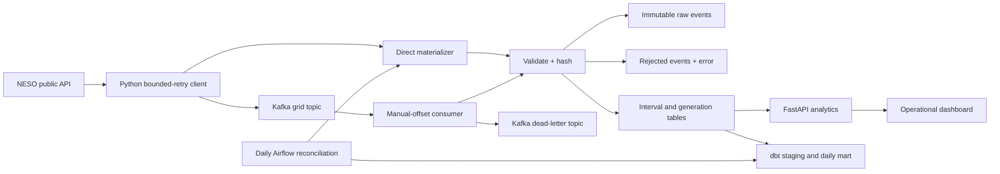

# SignalFlow architecture

SignalFlow translates public national-grid data into an observable, reproducible analytics product. It is the first project in a separate engineering portfolio, supporting data engineering, analytics, analytics engineering, and backend applications. It is not the entire portfolio website.

## Two execution paths

**Local, verified:** public HTTP API → Python → SQLite → FastAPI → browser dashboard. A polling worker refreshes the preceding two days every five minutes so delayed actuals and revisions are reconciled. SQLite uses WAL, with a 30-second lock timeout. Data persists under `data/`, excluded from Git.

**Container path, verified locally:** the same materializer writes PostgreSQL 16. The `streaming` profile uses a Kafka 3.9 KRaft broker, explicit topic creation, a producer and a consumer. The `polling` profile uses direct ingestion instead. Airflow runs a separate daily seven-day reconciliation followed by `dbt build` and a freshness check. Do not enable both producer paths casually: the sinks deduplicate, but duplicate source polling adds cost without benefit.

## Contracts and data model

- `raw_events`: SHA-256 identity over kind and canonical payload; original JSON text, received time, accepted/rejected state and error. Rejected nonfinite values may be retained as nonstandard JSON text; they never reach the analytical tables.
- `observations`: primary key UTC interval start; end, forecast, nullable actual, source intensity label, ingestion time, raw-event reference. Actuals can be revised. A delayed forecast-only event is retained in raw storage but cannot overwrite a previously observed row.
- `generation`: composite key interval start + fuel; percentage, end, ingestion time, raw-event reference. A revision atomically replaces the complete interval mix, removing superseded fuels.
- `pipeline_runs`: durable start/finish/status and fetched, inserted, rejected counts for direct ingestion, including failed partial runs. `inserted` counts newly accepted raw events, including revisions; it is not the number of new intervals. Kafka consumption does not populate this run table.
- `analytics.stg_grid_intervals`: typed UTC timestamps and forecast residuals.
- `analytics.mart_grid_daily`: day-level observed coverage, mean/min/max carbon intensity and forecast MAE. API calculations currently query base tables directly; dbt is a separate analytical consumption layer.

DDL is created by SQLAlchemy at startup for schema v1. PostgreSQL bootstrap uses a transaction-scoped advisory lock so concurrent API/worker startup does not race table creation. Event claims use `INSERT ... RETURNING`, since driver row counts are not reliable for conflict detection. Changes to deployed schema need an explicit migration; `create_all` does not migrate columns. SQLite is a development store, not a distributed warehouse.

## Delivery and failure semantics

A raw event claim and its projections commit in one database transaction. Unique constraints and conflict handling make exact replays no-ops. Kafka keys preserve order per kind and interval; partitions distribute independent intervals. The consumer commits only after successful database processing (and dead-letter publication for rejections). A crash after database commit but before offset commit causes safe replay. DLQ delivery is at least once and may duplicate around a crash. No cross-system exactly-once guarantee is claimed.

HTTP timeouts are 25 seconds per attempt. Connection errors, malformed responses, rate limits and 5xx responses get four attempts with bounded exponential backoff; permanent 4xx responses fail immediately. A source failure leaves previously committed intervals intact, records a failed run, and is retried on the next worker cycle. Do not expose raw exception details or this unauthenticated local service directly to an untrusted audience.

## Analytics definitions

- Carbon intensity: grams CO₂ per kWh, national average, as published by NESO; forecast and observed actual remain distinct.
- Renewable share: wind + solar + hydro. Biomass is intentionally excluded from this product definition. This is not a complete lifecycle assessment.
- MAE: average absolute difference between actual and forecast, excluding null actuals.
- Actual coverage: fraction of stored intervals in the selected window with nonnull actuals. It does not measure whether every expected source interval exists.
- Anomalies: current observed value versus up to 48 preceding stored observations within the selected window; at least 12 actuals; standard-deviation floor 10; flag at absolute z ≥ 3, high at ≥ 4. No lookahead. Missing intervals can make the baseline span more than a day.
- Freshness: age of latest stored interval **end**, not time of fetch. Both intensity and generation must be within 90 minutes. `healthy` is dataset freshness plus direct-run outcome, not independent proof every Kafka service is running.
- Scenario: exhaustive contiguous historical windows in the last seven days of stored data; all intervals must have observed actuals and exact 30-minute adjacency. Facility kWh = IT kW × hours × PUE. kgCO₂ = kWh × mean observed gCO₂/kWh ÷ 1000. Lowest/highest windows are hindsight comparisons, not future forecasts, prices, demand response commitments, or schedulable recommendations.

This system does not ingest GPU utilization, data-center load, energy prices, or market trading feeds. Its AI-infrastructure relevance is a modeled compute-energy scenario over public grid signals.

## Source and attribution

[NESO Carbon Intensity API](https://api.carbonintensity.org.uk/), [official API definitions](https://carbon-intensity.github.io/api-definitions/). Data is licensed CC BY 4.0. Endpoints: `/intensity/{from}/{to}` and `/generation/{from}/{to}`, fetched in daily UTC chunks. Preserve attribution when redistributing extracts. Backfills are limited to 1–30 days per invocation. Source retention and availability are upstream constraints.
